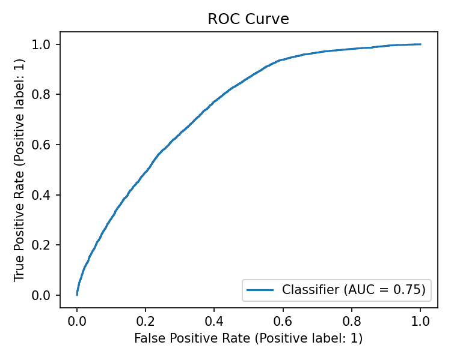
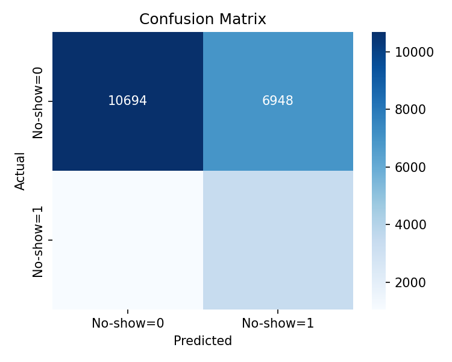

# Patient No-Show Prediction: AI Insights Dashboard

An interactive Streamlit dashboard that predicts the probability a patient will miss a scheduled medical appointment, explains each prediction with SHAP, and narrates dataset-level insights with an LLM that is strictly grounded in precomputed numbers, so it cannot invent statistics.

Built on the [Kaggle Medical Appointment No-Shows dataset](https://www.kaggle.com/datasets/joniarroba/noshowappointments) (110K+ appointments).


## Highlights

- **XGBoost classifier** tuned with `GridSearchCV` and `StratifiedKFold`, optimizing ROC-AUC (test ROC-AUC: **0.74**).
- **Leakage-aware features:** neighbourhood no-show rate is computed on the training split only, then mapped to the test split.
- **Imbalance handled** with `scale_pos_weight`, with no resampling.
- **Explainable:** SHAP `TreeExplainer` for per-patient and global explanations.
- **Grounded LLM narration:** Llama 3.1 8B Instruct (Mistral 7B fallback) via the Hugging Face Inference API, restricted to numbers from a precomputed JSON summary.
- **Graceful fallback:** without a token, the app shows raw SHAP values and data summaries instead of failing.

## Results

Evaluated on an untouched 20% stratified test set.

| Metric | Value |
| --- | --- |
| ROC-AUC | 0.74 |
| Accuracy | add value from train.py output |
| Recall (no-show class) | add value from train.py output |




## Dashboard tabs

1. **Dataset Insights:** key metrics and no-show rates by day of week, lead time, age group, and SMS reminder status.
2. **Risk Predictor:** enter a patient and appointment profile to get a risk %, a risk band (Low, Moderate, High), and a recommended action.
3. **Model Performance:** accuracy, ROC-AUC, confusion matrix, ROC curve, feature importance, and the training methodology.
4. **AI Insights:** ask questions about the dataset or generate an executive summary. If the data can't answer, the model says so instead of estimating.

## Tech stack

- **Data and features:** pandas, numpy
- **Model:** XGBoost (`XGBClassifier`), `GridSearchCV`, `StratifiedKFold`
- **Explainability:** SHAP (`TreeExplainer`)
- **LLM narration:** Hugging Face Inference API (Llama 3.1 8B Instruct, Mistral 7B fallback)
- **App:** Streamlit

## Project structure

```
.
├── app.py                 Streamlit app (4 tabs)
├── preprocessing.py       Raw CSV to cleaned, feature-engineered CSV
├── train.py               Train and tune XGBoost, save model and plots
├── shap_explainer.py      SHAP explainer and driver extraction
├── llm_client.py          Hugging Face client and grounded prompts
├── data/
│   ├── raw_appointments.csv        (not included, see Setup)
│   └── processed_appointments.csv  (generated)
├── model/noshow_model.pkl (generated)
├── plots/                 (generated)
├── requirements.txt
└── .env.example
```

## Setup

1. **Clone and install**
   ```
   git clone https://github.com/Rishita-23/Medical-NoShow-.git
   cd Medical-NoShow-
   python -m venv .venv
   source .venv/bin/activate        # Windows: .venv\Scripts\activate
   pip install -r requirements.txt
   ```
2. **Get the data:** download the [Kaggle dataset](https://www.kaggle.com/datasets/joniarroba/noshowappointments) and save it as `data/raw_appointments.csv`.
3. **Set your token (optional):**
   ```
   cp .env.example .env
   ```
   Add `HF_TOKEN=your_token_here` to `.env`. Use a fine-grained token with only the "Make calls to Inference Providers" permission. The app works without a token.
4. **Run the pipeline**
   ```
   python preprocessing.py
   python train.py            # add --quick for a single fast configuration
   ```
5. **Launch**
   ```
   streamlit run app.py
   ```

## Model methodology

| Step | Detail |
| --- | --- |
| Preprocessing | Clean the raw CSV, engineer features (lead time, day of week, comorbidity score, patient history), drop invalid rows |
| Split | 80/20 stratified train/test split |
| Neighbourhood rate | Computed from the training split only; unseen neighbourhoods fall back to the training global rate |
| Scaling | `StandardScaler`, fit on the training set only |
| Class balance | `scale_pos_weight`, no resampling |
| Tuning | `GridSearchCV` with `StratifiedKFold`, optimizing ROC-AUC |
| Evaluation | Untouched test set |
| Explainability | SHAP `TreeExplainer`, per prediction and in batch |

## AI grounding design

The narration layer (`llm_client.py`) is built so it can't hallucinate clinical statistics:

- A system prompt restricts the model to numbers given in that prompt.
- Each prompt embeds a precomputed JSON summary or SHAP driver list as the only source of truth, and the model must say "I don't have that specific figure" rather than guess.
- If the API is unavailable, the app falls back to raw SHAP values or the JSON summary.

## Security

`.env` is git-ignored and must never be committed. Use `.env.example` as the template. If a token is ever exposed, revoke it immediately at huggingface.co/settings/tokens.

## Limitations

- Trained on a public historical dataset; not validated on a real clinic's population.
- The free Hugging Face tier can be slow on the first request after idle time.

## Disclaimer

Predictions and AI-generated narration are for demonstration only and must not inform real clinical or scheduling decisions without further validation.
